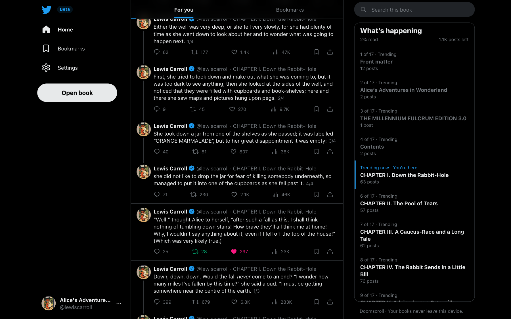
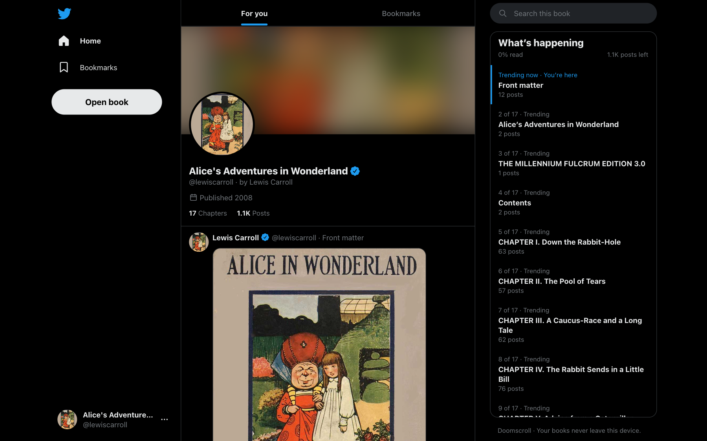
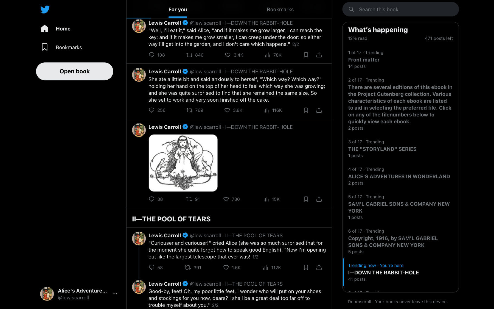
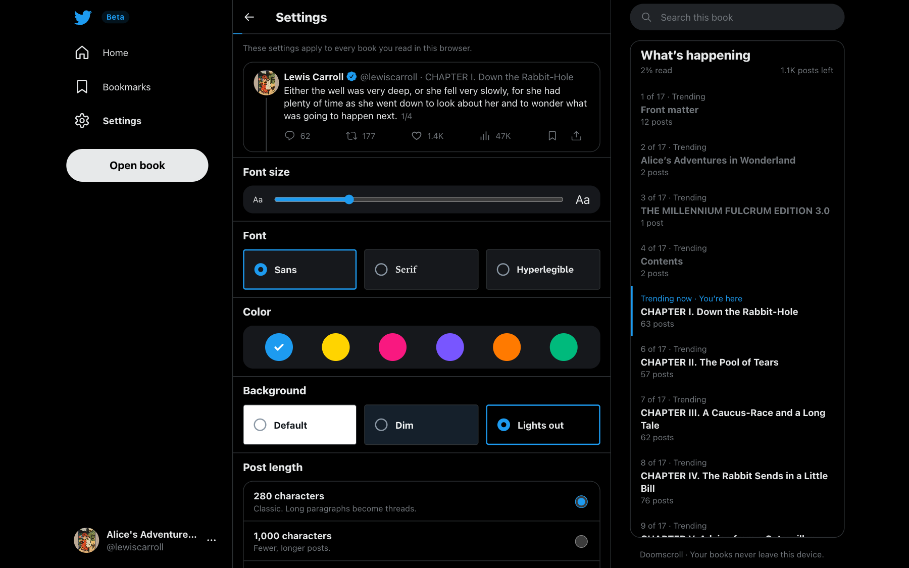
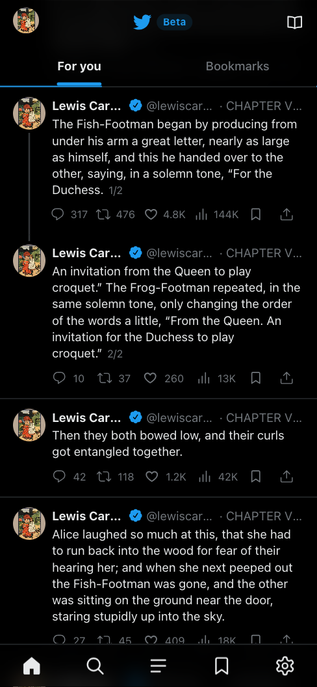
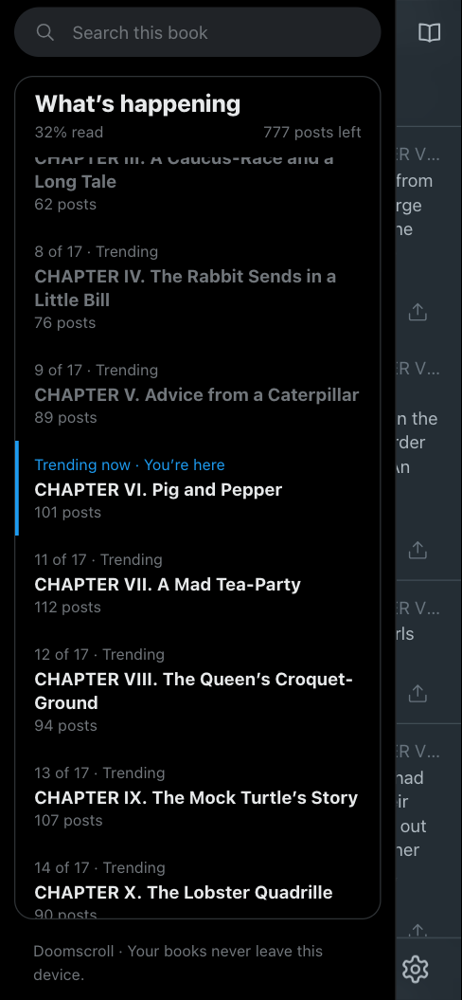
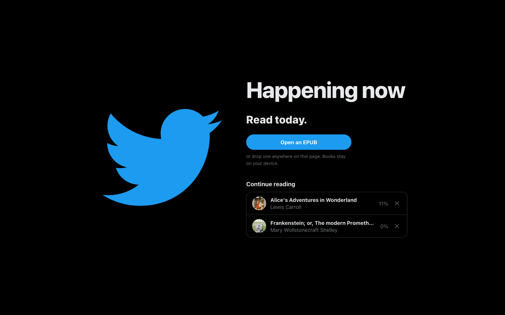

# Doomscroll

Doomscroll turns an EPUB into a Twitter timeline, so you can read a book the way you'd doomscroll in Lights Out mode. Each paragraph is a post from the author. Long paragraphs become threads, chapters trend in the sidebar, and footnotes show up as replies.

Everything runs in your browser. The book is parsed on your device and saved in IndexedDB, and nothing is uploaded.

Try it at [doomscroll.jaleel.me](https://doomscroll.jaleel.me). Bring your own EPUB, or tap **Try it with Alice in Wonderland** to read the bundled demo book.

Doomscroll is in beta. Books with unusual markup can still come out wrong. If a book looks broken, [open an issue](https://github.com/Jaleel-VS/doomscroll/issues) and say which book it was.



## Run it

You need Node and pnpm.

```sh
pnpm install
pnpm dev      # http://localhost:5173
```

Open an `.epub` or drop one anywhere on the page. The last book you read reopens at the post you were on.

Other scripts:

```sh
pnpm build    # static site in build/
pnpm test     # unit tests
pnpm check    # svelte-check
```

`pnpm build` writes a static site, so you can host `build/` anywhere that serves files.

## What it looks like

The top of the feed is the book's profile: the cover is the avatar, and the header lists the authors, the publication year, and the chapter and post counts.



Illustrations become media posts, and chapter headings become section breaks in the feed.



Settings has a live preview of the post you're on, like Twitter's display settings.



On a phone you get the mobile layout: a bottom tab bar, and a drawer for search and chapters that opens when you tap your avatar. Like X, the header follows your finger: it slides away as you scroll down and comes back as soon as you scroll up.

| Feed | Chapters |
| --- | --- |
|  |  |

The landing page keeps a list of the books you've opened, with how far you got in each.



The screenshots use public-domain books from [Project Gutenberg](https://www.gutenberg.org/).

## How a book becomes a feed

| In the EPUB | In the feed |
| --- | --- |
| Paragraph, list item, or loose text | A post. Lists keep their `•` or `1.` markers. |
| Paragraph over 280 characters | A thread, split at sentence ends into posts of similar length. The limit is a setting. |
| `h1` to `h6`, a large-font CSS class, or a line that matches the table of contents | A section header. |
| Table of contents (EPUB 3 nav or NCX) | The "What's happening" trends, with post counts and your progress. |
| `blockquote` | A quote card. |
| `figure` or image | A media post. The caption is the post text. Click the image to open it full screen. |
| `table` | A table card that keeps `rowspan` and `colspan`. Single-column layout tables are unwrapped. |
| MathML (`math`) | Rendered equations. Display equations get their own line. Only MathML elements and layout attributes are kept. |
| `pre`, monospace CSS, or a shaded box with one `div` per line | A code card. |
| Footnote reference (`noteref` type or role, or a superscript link) | The reply count. Click it to read the note as a reply. |
| The book's own contents page | Dropped, because the sidebar already lists the chapters. |
| `dc:creator` and `dc:contributor` | The first author writes every post. The profile lists every author, plus translators and illustrators. |

Bold, italic, and monospace come from the HTML tags and from the book's CSS classes. That matters for books converted with Calibre, which often style everything through classes.

The like, repost, reply, and view counts are made up. They come from a hash of each post, so they stay the same between visits. Your likes, reposts, and bookmarks are real and saved per book.

You can reply to any post. Your replies sit under the post next to its footnotes, count toward its reply number, and are saved with your bookmarks. Press `r` to reply to the post you're on, and `Cmd`+`Enter` or `Ctrl`+`Enter` to send.

The share button copies a post's text with a credit line, or draws the post as an image in your current theme. On a phone the image goes to the share sheet; on a computer it downloads.

## Settings

Settings is in the side navigation, or the gear in the bottom bar on a phone. It works like Twitter's display settings, with a live preview of the post you're on.

| Setting | Options |
| --- | --- |
| Font size | Five steps, from 14 to 21 pixels |
| Font | Sans, Serif, or Hyperlegible ([Atkinson Hyperlegible Next](https://www.brailleinstitute.org/freefont/), bundled with the app) |
| Color | Twitter's six accent colors |
| Background | Default (light), Dim, or Lights out |
| Post length | 280 characters, 1,000 characters, or no limit (one post per paragraph) |
| Engagement | Show or hide the made-up like and view counts |

Settings apply to every book in the browser. Changing the post length re-reads the open book and keeps your place, likes, and bookmarks.

## Where your data lives

Everything stays in the browser you read in.

| What | Where |
| --- | --- |
| Book files and covers | IndexedDB, database `doomscroll` |
| Reading position, likes, reposts, bookmarks, and your replies | `localStorage`, one `state:` entry per book |
| Settings | `localStorage`, key `settings` |

Positions and bookmarks are saved by spine document and opening words, not by post number. They survive parser updates and post-length changes. Clearing site data, or reading on another device, starts from scratch. **Settings** > **Clear library** removes every book and its progress.

Doomscroll asks the browser to keep its storage persistent, so saved books aren't evicted when disk space runs low. Browsers decide whether to grant that.

## Install it and read offline

Doomscroll is an installable web app. On a phone, use **Share** > **Add to Home Screen** (Safari) or **Install app** (Chrome). On a computer, use the install button in the address bar.

A service worker caches the app, so it opens and reads saved books with no connection. Adding it to the Home Screen also matters on iPhone, because Safari can delete storage for sites you haven't visited in a while, and Home Screen apps are exempt.

## Keyboard shortcuts

| Key | Action |
| --- | --- |
| `j` | Next post |
| `k` | Previous post |
| `l` | Like |
| `t` | Repost |
| `r` | Reply |
| `b` | Bookmark |
| `/` | Search the book |
| `Esc` | Close the drawer |

## Limits

- Doomscroll needs a recent browser: Chrome 119, Safari 17.4, Firefox 125, or later. It relies on the built-in `DecompressionStream`, `Intl.Segmenter`, and `Promise.withResolvers`.
- There's no DRM support.
- ZIP64 archives don't open. EPUBs are rarely large enough to use ZIP64.
- Equations written as LaTeX source in the text, rather than MathML, show as that source.
- Book metadata is shown as the book provides it. A messy title in the EPUB is a messy title in the feed.

## Code layout

| Path | What it does |
| --- | --- |
| `src/lib/epub/zip.ts` | Reads the EPUB's ZIP archive with the browser's `DecompressionStream`. |
| `src/lib/epub/parse.ts` | Turns the package, table of contents, and chapters into posts. |
| `src/lib/epub/split.ts` | Splits long paragraphs into threads. |
| `src/lib/reader.svelte.ts` | Holds the reading state: the rendered window of posts, jumps, likes, bookmarks, and search. |
| `src/lib/storage.ts` | Saves books to IndexedDB and reading progress to `localStorage`. |
| `src/lib/locator.ts` | Turns post numbers into locators that survive re-parsing, and back. |
| `src/lib/settings.svelte.ts` | Holds display settings and applies them as CSS variables. |
| `src/lib/components/` | The Twitter-style UI. |

## Credits

The demo book is [*Alice's Adventures in Wonderland*](https://standardebooks.org/ebooks/lewis-carroll/alices-adventures-in-wonderland/john-tenniel) by Lewis Carroll, illustrated by John Tenniel, in the [Standard Ebooks](https://standardebooks.org/) edition. The text and illustrations are in the public domain, and Standard Ebooks dedicates its work on the edition to the public domain under [CC0](https://creativecommons.org/publicdomain/zero/1.0/). The copy in `static/demo/` is repacked with smaller images (the 2x illustrations removed and the rest reduced to 16 greys) to keep the download under 3 MB.

Doomscroll isn't affiliated with Twitter or X. The bird logo belongs to X Corp.
